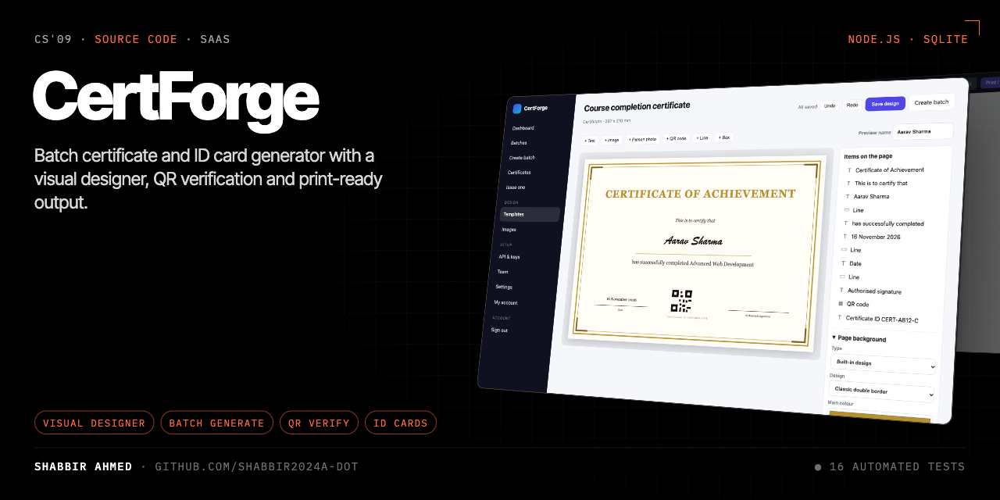
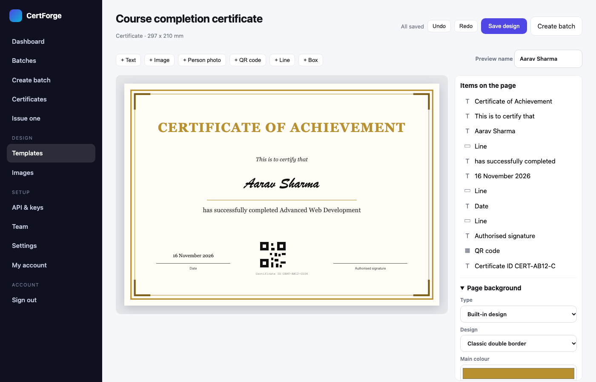

# CertForge

Make certificates and event ID cards in bulk from a list of names. Design them in a visual editor, print them as PDFs, and give every one a QR code that anyone can verify online.

## Features

- Visual designer: drag and resize text, photos, logos, signatures and QR codes
- Placeholders like `{{name}}` become columns in your list
- Batches of up to 2,000 from CSV or a paste from Excel / Google Sheets
- Print-ready PDFs; ID cards in credit-card size, 10 per A4 sheet
- Hindi, Bengali and Tamil names checked and printing correctly
- Public verification page per certificate, revoke / reinstate, REST API

## Screenshots

**Designer**

**ID card sheet**

**Verification page**

## Built with

Node.js 22+ with built-in SQLite · zero dependencies · 16 end-to-end tests

## Get the source code

The source code is **not in this repository**. It is sold as a one-time purchase that includes the full code, a setup guide and a licence to run it for your business or clients.

---

Made by [Shabbir Ahmed](https://github.com/shabbir2024a-dot) · Guwahati, India
